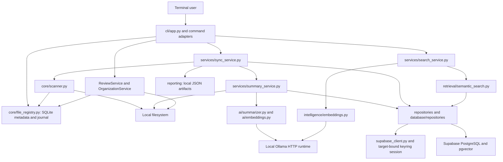
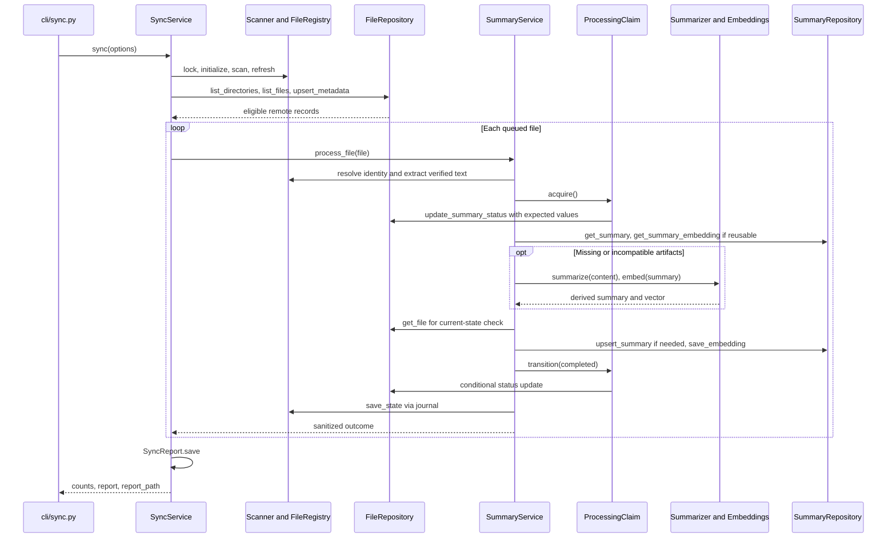
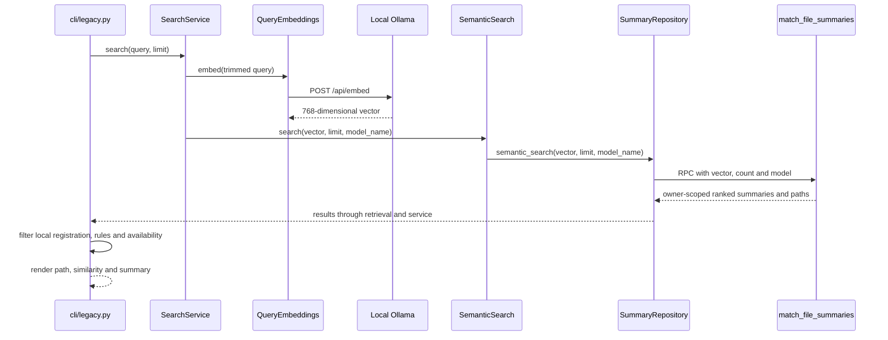

# Searchify developer guide

This is a guided tour of the implementation. Read [the recommended path](#3-the-recommended-reading-order) from top to bottom, then use the execution traces and navigation tables when changing a feature. Paths are relative to this document and open the source on GitHub.

## 1. Start here: understanding the project

Searchify is a Python CLI for discovering local files. It registers explicit directory roots, inventories their metadata, detects content changes, generates descriptions using local Ollama models, and stores derived summaries and vectors in Supabase for semantic retrieval. It also offers local filename search, diagnostics, saved synchronization reports, and conservative review/organization proposals.

The application has three different kinds of operations:

- **Local metadata operations:** registration, indexing, filename search, workspace inspection, and recommendation generation.
- **Processing operations:** sync and standalone summarization read eligible local text, produce summaries, embed those summaries, and persist derived artifacts remotely.
- **Semantic queries:** embed the query locally, rank remote summary vectors, then filter results against local registrations and availability in the CLI.

There is no application HTTP server or API router. Python services are the application boundary; Supabase exposes database operations through its SDK/PostgREST interface and a SQL RPC (a remotely callable database function).



A typical processing lifecycle is: **register → scan → classify → reconcile remote metadata → claim a file → extract and verify → summarize → embed summary → save derived records → mark completed → publish report**. Later syncs reuse compatible completed artifacts. Search is a separate read path; it does not regenerate summaries.

### Boundaries to understand before reading

The executable implementation is more specific than some older descriptions and placeholder docstrings:

- Filename search is parameterized SQLite substring matching, not FTS5. The historical source-text search cache is removed by the indexer.
- Large inputs already use 12,000-character chunks and hierarchical merging in the active AI summarizer. Chunks remain in memory; there is no persisted chunk retrieval pipeline.
- Hybrid fusion, reranking, deep search, and query understanding are placeholders. Their presence in the tree does not mean they run.
- Review may read candidate bytes to verify duplicates; it is not an AI indexing operation. Organize produces proposals and has no execution mode.
- The current search service does not record query history automatically, although the schema and a repository support it.

## 2. Repository structure

```text
Searchify/
├── pyproject.toml                 Python package, dependencies, console entry point
├── package.json                  Supabase CLI development dependency
├── Modelfile                     Ollama model configuration asset
├── .github/workflows/tests.yml    Regression, smoke, build, advisory lint jobs
├── searchify/
│   ├── __main__.py                Public Python/console entry
│   ├── cli/                       Argument parsing and command presentation
│   ├── config/                    Settings and environment loading
│   ├── core/                      Registry, scanner, extraction, rules
│   ├── indexer.py                  SQLite base schema and compatibility helpers
│   ├── repositories/              Application-facing remote repositories
│   ├── database/
│   │   ├── supabase_client.py      Shared client re-export
│   │   └── repositories/          Base remote CRUD and query-history access
│   ├── services/                  Processing, search, diagnostics, recommendations
│   ├── ai/                        Local model transport and generation
│   ├── intelligence/              Query embeddings plus reserved components
│   ├── retrieval/                 Semantic adapter plus reserved components
│   ├── reporting/                 Sanitized JSON reports, history, artifacts
│   ├── ui/                        Terminal mascot and artwork
│   ├── supabase_client.py         Authentication and client cache
│   ├── migrate_directories.py     Standalone metadata migration helper
│   └── migrate_files.py           Standalone metadata migration helper
├── supabase/
│   ├── config.toml                Local Supabase configuration
│   ├── migrations/                Ordered remote schema and RPC definitions
│   └── tests/                     PostgreSQL acceptance SQL
├── tests/                         unittest regression suite and live harness
└── docs/                          Developer documentation
```

The directory boundaries describe responsibilities, not separate deployable applications:

| Directory | What belongs here and why | Main interactions |
|---|---|---|
| [cli](../searchify/cli) | Argument contracts, exit codes, progress and terminal rendering; keep orchestration in services. | Calls services, registry/indexer, reporting and UI. |
| [config](../searchify/config) | Runtime settings and filesystem destinations; no database records. | Read by providers, repositories, services and CLI. |
| [core](../searchify/core) | Local file eligibility, traversal, extraction and SQLite registry/journal access. | Scanner reads registry and extractor; indexing and processing use all three. |
| [repositories](../searchify/repositories) | Application-facing Supabase operations, local eligibility checks, conditional updates and persistence validation. | Extends base database repositories; called by services and retrieval. |
| [database/repositories](../searchify/database/repositories) | Base owner-scoped table operations and optional history operations. | Uses the shared authenticated database client; extended by application repositories. |
| [services](../searchify/services) | Business workflows and policy: sync, shared per-file processing, search, health and proposals. | Coordinates core, repositories, AI and reporting. |
| [ai](../searchify/ai) | Ollama transport, summarization, embedding and summary privacy checks. | Settings configure providers; SummaryService supplies text and consumes results. |
| [intelligence](../searchify/intelligence) | Active query-specific embedding validation; other files reserve future capabilities. | QueryEmbeddings extends the AI embedding provider for SearchService. |
| [retrieval](../searchify/retrieval) | Active semantic repository adapter; other files are placeholders. | SearchService → SemanticSearch → SummaryRepository → SQL RPC. |
| [reporting](../searchify/reporting) | Safe outcome structures, error classification, append-only JSON publication and reading. | Sync produces reports; CLI renders them; recommendation commands optionally save artifacts. |
| [ui](../searchify/ui) | Packaged ANSI artwork and banner rendering. | Used by the welcome screen; separate from general CLI output helpers. |
| [supabase](../supabase) | Remote database contract and local stack configuration. | Python repositories must agree with migrations; SQL tests exercise actual database behavior. |
| [tests](../tests) | Behavior verification with temporary files, fake remote state/HTTP, and an explicit live runner. | Exercises production modules without requiring normal tests to access providers. |

## 3. The recommended reading order

Follow the numbered steps. Each **Next** link is the next file to open; it either follows a caller into its dependency or introduces a prerequisite before returning to orchestration. This is a learning order, not a claim that every module executes sequentially in one command. Remote schema reading comes before the repositories that consume it; AI providers come before the full sync walkthrough.

### Stage 1: application entry points and CLI

**1. [pyproject.toml](../pyproject.toml) — The packaging contract.**

- **Inspect:** `[project.scripts]`, runtime dependencies and package data.
- **Learn:** Python ≥3.10, the installed console entry, and why Node tooling is not the application runtime.
- **Next:** [searchify/__main__.py](../searchify/__main__.py). Follow the declared console entry.

**2. [searchify/__main__.py](../searchify/__main__.py) — The public executable shim.**

- **Inspect:** imported `main` and the module execution guard.
- **Learn:** Both the installed command and Python module converge on the same parser.
- **Next:** [searchify/cli/app.py](../searchify/cli/app.py). Open the actual command dispatcher.

**3. [searchify/cli/app.py](../searchify/cli/app.py) — The command map and error boundary.**

- **Inspect:** `build_parser`, `main`, `positive_int`, `result_limit`.
- **Learn:** Handlers are lazy `module:function` strings; help does not initialize operational providers. Observe parser errors and sanitized exit handling.
- **Next:** [searchify/cli/sync.py](../searchify/cli/sync.py). Inspect a concrete handler before its service.

**4. [searchify/cli/sync.py](../searchify/cli/sync.py) — Sync arguments and terminal progress.**

- **Inspect:** `add_arguments`, `run`, `ProgressDisplay`.
- **Learn:** The CLI translates flags and callbacks; SyncService owns the work. Keep that service tab for Stage 7.
- **Next:** [searchify/core/extractor.py](../searchify/core/extractor.py). Learn what source text can enter processing.


### Stage 2: core utilities and foundational abstractions

**5. [searchify/core/extractor.py](../searchify/core/extractor.py) — The bounded UTF-8 reader.**

- **Inspect:** `extract_content`, `TEXT_EXTENSIONS`, `MAX_CONTENT_SIZE`.
- **Learn:** Extension, byte limit, binary and decoding checks; strict mode propagates OS read failures.
- **Next:** [searchify/indexer.py](../searchify/indexer.py). See how extracted text becomes an identity hash and metadata.

**6. [searchify/indexer.py](../searchify/indexer.py) — Base local schema and compatibility operations.**

- **Inspect:** `connect`, `initialize`, `calculate_hash`, `resolve_indexed_file`, `index_all`, `search_files`, `purge_legacy_content`.
- **Learn:** Hashes represent extracted UTF-8 text. Resolution checks registration and rules; filename search reads metadata. Prefer current index_all over the older index_directory helper.
- **Next:** [searchify/core/file_registry.py](../searchify/core/file_registry.py). Move from base tables to the current registry interface.

**7. [searchify/core/file_registry.py](../searchify/core/file_registry.py) — Local registrations and durable per-file progress.**

- **Inspect:** `FileRegistry.connection`, `initialize_journal`, `lock`, `register`, `refresh`, `save_state`.
- **Learn:** Read-only connections, local transactions, directory rules and the separate sync journal; the lock is a filesystem advisory lock.
- **Next:** [searchify/config/settings.py](../searchify/config/settings.py). Identify shared configuration before studying file eligibility.


### Stage 3: configuration and data contracts

**8. [searchify/config/settings.py](../searchify/config/settings.py) — Shared immutable configuration.**

- **Inspect:** `Settings`, `Settings.validate`, module-level `settings`.
- **Learn:** Environment/.env loading, model provenance and output paths. Importing settings alone does not invoke validate. Some constants are Python defaults rather than environment knobs.
- **Next:** [searchify/core/scanner.py](../searchify/core/scanner.py). Settings and extraction limits constrain scanning rules.

**9. [searchify/core/scanner.py](../searchify/core/scanner.py) — Rule and scan-entry contracts.**

- **Inspect:** `DirectoryRules`, `from_dict`, `to_dict`, `preset`, `Scanner.scan`, `signature`, `root_is_unredirected`.
- **Learn:** Per-root rules, protected paths, nested-root ownership, signature/hash reuse and incomplete-scan handling. Scan entries are dictionaries, not ORM entities.
- **Next:** [supabase/migrations/20261111132250_remote_schema.sql](../supabase/migrations/20261111132250_remote_schema.sql). Compare local metadata identities with remote UUID identities.

**10. [supabase/migrations/20261111132250_remote_schema.sql](../supabase/migrations/20261111132250_remote_schema.sql) — Initial remote table contract.**

- **Inspect:** directories/files definitions, composite foreign keys, RLS policies.
- **Learn:** Read the later [summary schema](../supabase/migrations/20261111143825_remote_schema.sql) in the same step: one summary per file, one embedding per summary, plus query tables. Historical chunk/job tables are not the current pipeline.
- **Next:** [searchify/database/repositories/files.py](../searchify/database/repositories/files.py). See the Python access layer for these tables.


### Stage 4: repositories and database interactions

**11. [searchify/database/repositories/files.py](../searchify/database/repositories/files.py) — Base file metadata access.**

- **Inspect:** `FileRepository`, `get_file`, `get_pending_summaries`, `update_summary_status`, `get_file_count`.
- **Learn:** Owner filters and Supabase query-builder operations. This base interface is extended for current sync behavior.
- **Next:** [searchify/database/repositories/summaries.py](../searchify/database/repositories/summaries.py). Read the paired summary storage contract.

**12. [searchify/database/repositories/summaries.py](../searchify/database/repositories/summaries.py) — Base summary and vector CRUD.**

- **Inspect:** `SummaryRepository.get_summary`, `upsert_summary`, `save_embedding`, `get_summary_embedding`.
- **Learn:** Conflict keys file_id and summary_id replace derived records in place; summary and vector writes are separate calls.
- **Next:** [searchify/repositories/files.py](../searchify/repositories/files.py). Add the concurrency and sync-specific behavior.

**13. [searchify/repositories/files.py](../searchify/repositories/files.py) — Current file repository.**

- **Inspect:** `FileRepository`, `get_pending_summaries`, `local_entry`, `update_summary_status`, `_pages`, `ensure_directory`, `upsert_metadata`, `mark_unavailable`, `move_metadata`.
- **Learn:** Pagination, locally eligible queue selection, expected-value update predicates and remote availability reconciliation.
- **Next:** [searchify/repositories/summaries.py](../searchify/repositories/summaries.py). Inspect validation on derived artifacts and the RPC boundary.

**14. [searchify/repositories/summaries.py](../searchify/repositories/summaries.py) — Current summary repository.**

- **Inspect:** `SummaryRepository.upsert_summary`, `save_embedding`, `semantic_search`.
- **Learn:** Reject nonempty summary_data, validate vectors, and send only vector/limit/model to the RPC. The caller never chooses the owner ID.
- **Next:** [searchify/supabase_client.py](../searchify/supabase_client.py). Understand where repository credentials and owner identities originate.

**15. [searchify/supabase_client.py](../searchify/supabase_client.py) — Authentication and target-specific client reuse.**

- **Inspect:** `authenticate`, `get_client`, `get_owner_id`, `save_session`, `logout`.
- **Learn:** Read [session_service.py](../searchify/services/session_service.py): canonical_target, session_account and decode_session bind keyring tokens to the target. [database/supabase_client.py](../searchify/database/supabase_client.py) only re-exports the shared accessors.
- **Next:** [searchify/services/processing_claim.py](../searchify/services/processing_claim.py). With remote updates understood, study processing ownership.


### Stage 5: backend services and business logic

**16. [searchify/services/processing_claim.py](../searchify/services/processing_claim.py) — Per-file leases and recovery.**

- **Inspect:** `ProcessingClaim.acquire`, `transition`, `_heartbeat`, `close`, `eligible_entry`, `recoverable`, `recover_claim`.
- **Learn:** Compare-and-swap updates, lease renewal, journal evidence and conservative recovery. A workspace lock and a remote claim solve different concurrency problems.
- **Next:** [searchify/services/summary_service.py](../searchify/services/summary_service.py). See the claim protecting actual processing.

**17. [searchify/services/summary_service.py](../searchify/services/summary_service.py) — Shared single-file business workflow.**

- **Inspect:** `SummaryService.process_file`, `_read_content`, `_check_current`, `_journal`, `_save_failure`, `process_pending`, `StaleContentError`.
- **Learn:** Content verification, artifact reuse, claimed persistence, stale versus failed outcomes and standalone queue processing. Read the call order now; inspect the provider implementations next.
- **Next:** [searchify/services/health_service.py](../searchify/services/health_service.py). Compare processing with diagnostics that must avoid authentication side effects.

**18. [searchify/services/health_service.py](../searchify/services/health_service.py) — Read-only diagnostics.**

- **Inspect:** `HealthService.snapshot`, `authentication`, `_providers`.
- **Learn:** Local metadata inspection, optional metadata-only scanning and provider probes. Also inspect [ReviewService.review](../searchify/services/review_service.py) and [OrganizationService.propose](../searchify/services/organization_service.py) for the independent recommendation branch.
- **Next:** [searchify/ai/ollama_client.py](../searchify/ai/ollama_client.py). Now enter the active AI implementation.


### Stage 6: intelligence, generation and retrieval

**19. [searchify/ai/ollama_client.py](../searchify/ai/ollama_client.py) — Local HTTP transport and provider errors.**

- **Inspect:** `OllamaClient`, `check_available`, `post`, `check_processing_runtime`, `format_processing_error`.
- **Learn:** Loopback-only HTTP, disabled proxy/redirect behavior, bounded retries and sanitized diagnostics.
- **Next:** [searchify/ai/summarizer.py](../searchify/ai/summarizer.py). Follow generation requests through this transport.

**20. [searchify/ai/summarizer.py](../searchify/ai/summarizer.py) — The active hierarchical summarizer.**

- **Inspect:** `Summarizer.summarize`, `_generate`.
- **Learn:** 12,000-character slices, groups-of-four recursive reduction, prompt policy and rejection of incomplete output. No chunk persistence or overlap is implemented.
- **Next:** [searchify/ai/summary_validation.py](../searchify/ai/summary_validation.py). See the independent check before any derived text is stored.

**21. [searchify/ai/summary_validation.py](../searchify/ai/summary_validation.py) — Final summary privacy checks.**

- **Inspect:** `validate_summary`.
- **Learn:** Heuristics reject obvious source and credential echoes; prompts alone do not enforce the persistence boundary. This is not a proof that all sensitive information is removed.
- **Next:** [searchify/ai/embeddings.py](../searchify/ai/embeddings.py). Follow the validated summary into vector generation.

**22. [searchify/ai/embeddings.py](../searchify/ai/embeddings.py) — Summary vector generation.**

- **Inspect:** `Embeddings.embed`, `validate_embedding`.
- **Learn:** Single-text /api/embed calls request 768 dimensions and disable truncation; vectors must satisfy numeric/shape checks.
- **Next:** [searchify/intelligence/embeddings.py](../searchify/intelligence/embeddings.py). See how query vectors share the same embedding space.

**23. [searchify/intelligence/embeddings.py](../searchify/intelligence/embeddings.py) — Query-specific embedding wrapper.**

- **Inspect:** `QueryEmbeddings.embed`.
- **Learn:** Adds nonempty-query and nonzero-vector requirements while reusing the summary embedding provider/model.
- **Next:** [searchify/services/search_service.py](../searchify/services/search_service.py). Follow query validation into retrieval orchestration.

**24. [searchify/services/search_service.py](../searchify/services/search_service.py) — Semantic search orchestration.**

- **Inspect:** `SearchService.search`.
- **Learn:** Query → QueryEmbeddings → SemanticSearch.search in [retrieval/semantic_search.py](../searchify/retrieval/semantic_search.py) → SummaryRepository.semantic_search. Read that adapter and validate_limit here.
- **Next:** [supabase/migrations/20261114120000_filter_unavailable_summary_search.sql](../supabase/migrations/20261114120000_filter_unavailable_summary_search.sql). Inspect the database function that actually ranks results.


### Stage 7: indexing and processing workflows

**25. [supabase/migrations/20261114120000_filter_unavailable_summary_search.sql](../supabase/migrations/20261114120000_filter_unavailable_summary_search.sql) — Current semantic RPC definition.**

- **Inspect:** `match_file_summaries`.
- **Learn:** Owner joins, enabled roots, eligible/completed files, fresh hashes, compatible nonzero vectors, cosine ranking and deterministic ties. It replaces the [initial RPC](../supabase/migrations/20261112160000_summary_semantic_search.sql).
- **Next:** [searchify/services/sync_service.py](../searchify/services/sync_service.py). Return to the orchestration layer with all dependencies understood.

**26. [searchify/services/sync_service.py](../searchify/services/sync_service.py) — Full incremental sync orchestration.**

- **Inspect:** `SyncService.sync`, `_classify_local`, `_prepare`, `_valid_remote_summary`, `_process_batch`, `_record`.
- **Learn:** Scan → metadata refresh → remote reconciliation → sequential batches → per-file processing → report. Inspect rename detection, reuse fast/slow paths, dry-run and retry policy. Batch size does not introduce parallel processing.
- **Next:** [searchify/cli/summarize.py](../searchify/cli/summarize.py). Compare sync with the second caller of the shared processing service.

**27. [searchify/cli/summarize.py](../searchify/cli/summarize.py) — Standalone pending-summary command.**

- **Inspect:** `add_arguments`, `run`.
- **Learn:** It invokes SummaryService.process_pending on existing metadata rather than running the full scan/reconciliation workflow. Safe claim recovery is automatic in the service.
- **Next:** [searchify/cli/legacy.py](../searchify/cli/legacy.py). Complete the read-side journey with both search modes.


### Stage 8: output, reporting and user interaction

**28. [searchify/cli/legacy.py](../searchify/cli/legacy.py) — Compatibility commands and search presentation.**

- **Inspect:** `add`, `index`, `search`.
- **Learn:** Default search delegates to indexer.search_files; semantic search filters ranked remote paths through local registrations, existence and rules without reading source contents.
- **Next:** [searchify/reporting/sync_report.py](../searchify/reporting/sync_report.py). Learn how processing outcomes become durable diagnostics.

**29. [searchify/reporting/sync_report.py](../searchify/reporting/sync_report.py) — Outcome and report data contracts.**

- **Inspect:** `describe_error`, `make_outcome`, `SyncReport.record`, `snapshot`, `save`, `safe_error_message`.
- **Learn:** Allowlisted diagnostics, per-file counts, error stages and atomic publication without replacing history.
- **Next:** [searchify/cli/reports.py](../searchify/cli/reports.py). See how those contracts reach the terminal.

**30. [searchify/cli/reports.py](../searchify/cli/reports.py) — Saved report renderer.**

- **Inspect:** `render_report`, `run`.
- **Learn:** Read-only report viewing and verbose diagnostics; [reporting/history.py](../searchify/reporting/history.py) supplies load_reports and [reporting/artifacts.py](../searchify/reporting/artifacts.py) supplies save_artifact for explicit recommendation saves.
- **Next:** [searchify/cli/workspace.py](../searchify/cli/workspace.py). Finish the user-facing overview and status path.


### Stage 9: tests and verification

**31. [searchify/cli/workspace.py](../searchify/cli/workspace.py) — Welcome, status and directory inventory.**

- **Inspect:** `local_paths`, `read_workspace`, `welcome`, `status`, `directories`.
- **Learn:** Startup inspects existing state. Read [output.py](../searchify/cli/output.py) for literal/line/table, [directories.py](../searchify/cli/directories.py) for registration handlers, and [ui/mascot.py](../searchify/ui/mascot.py) for show_banner/render_mascot.
- **Next:** [tests/test_cli.py](../tests/test_cli.py). Verify the public command and read-only startup contracts.

**32. [tests/test_cli.py](../tests/test_cli.py) — CLI behavior and workspace contracts.**

- **Inspect:** `CommandTests`, `WorkspaceTests`.
- **Learn:** Parser/help coverage, lazy imports, routing, exit codes and no processing on startup.
- **Next:** [tests/test_pipeline_e2e.py](../tests/test_pipeline_e2e.py). Then verify the connected processing and search system.

**33. [tests/test_pipeline_e2e.py](../tests/test_pipeline_e2e.py) — Offline production-path integration.**

- **Inspect:** `OfflinePipelineTests`.
- **Learn:** Real scanner/repository/HTTP-client paths with fake boundaries. Read [pipeline_support.py](../tests/pipeline_support.py) for PipelineWorkspace, MemorySupabase, FakeOllama and exercise_lifecycle; compare [fakes.py](../tests/fakes.py) for simpler unit-test boundaries.
- **Next:** [tests/live_pipeline.py](../tests/live_pipeline.py). Understand what offline simulation cannot establish.

**34. [tests/live_pipeline.py](../tests/live_pipeline.py) — Explicit live acceptance harness.**

- **Inspect:** `live_configuration`, `run_live`, `main`.
- **Learn:** Both opt-ins, literal loopback targets, isolated credentials and disposable user cleanup. End with [summary_semantic_search.sql](../supabase/tests/summary_semantic_search.sql) to inspect transactional real-database ranking/RLS checks.
- **Next:** [.github/workflows/tests.yml](../.github/workflows/tests.yml). Finish at the authoritative automated development checks.

**35. [.github/workflows/tests.yml](../.github/workflows/tests.yml) — CI verification contract.**

- **Inspect:** test matrix, smoke commands, wheel build and advisory lint job.
- **Learn:** Normal regression is offline; live acceptance is separate. The reading tour ends here.
- **Next:** [docs/DEVELOPER_GUIDE.md](DEVELOPER_GUIDE.md). Return to the execution traces below, then choose a modification scenario.

## 4. Trace real execution flows

### Register and index a root

Entry: [cli/app.py](../searchify/cli/app.py). The `dirs add` handler is [cli/directories.py](../searchify/cli/directories.py) `add`, which constructs rules through `DirectoryRules.preset` and calls `FileRegistry.register`. Registration creates local metadata/rules but does not run AI or upload files. `configure` changes one root's rules; `remove` unregisters metadata after confirmation and leaves original files and remote records intact.

The separate `index` command goes through [cli/legacy.py](../searchify/cli/legacy.py) `index` → [indexer.py](../searchify/indexer.py) `index_all` → workspace lock → registry initialization → `Scanner.scan` → `FileRegistry.refresh` and `save_state`. Text is extracted only when needed for hashing, then discarded. Outputs are local file metadata, journal state and terminal counts; this path does not generate remote summaries.

### Incremental synchronization and one file's processing

Entry: [cli/sync.py](../searchify/cli/sync.py) `run` → [SyncService.sync](../searchify/services/sync_service.py).

1. Acquire the local workspace lock and initialize the metadata/journal schema. `Scanner.scan` returns entry dictionaries, metrics and scan information; entries carry identity, eligibility, change classification and reasons.
2. `FileRegistry.refresh` writes scanned metadata; `_classify_local` journals local exclusions/failures. `_prepare` fetches remote directories/files, ensures missing directory records, reconciles removals/nested roots, handles unique-hash renames and builds the processing queue through the current file repository.
3. `_valid_remote_summary` checks completion/hash and can trust matching local completion/model/version evidence as a fast path. Otherwise it verifies the stored summary and vector. Reuse is conditional, not simply “same filename.”
4. `_process_batch` checks the providers and calls [SummaryService.process_file](../searchify/services/summary_service.py) sequentially. `_read_content` resolves locally registered identity, applies rules, extracts text and verifies signatures/hash.
5. `ProcessingClaim.acquire` conditionally changes remote summary status to processing and starts heartbeat renewal. The service reuses a compatible stored summary/vector when possible; otherwise it calls `Summarizer.summarize`, `validate_summary` and `Embeddings.embed` on the summary.
6. Under the claim mutex, `_check_current` revalidates local and remote state. `SummaryRepository.upsert_summary` and `save_embedding` persist derived artifacts. A second check precedes `ProcessingClaim.transition("completed")`; local `_journal` records the outcome.
7. The sync `finally` block finalizes counts and attempts `SyncReport.save`, including on interrupted or failed runs. Failure to save the report is represented separately. The CLI renders progress and completion information.



The diagram shows the successful path. The heartbeat renews the claim in the background. Claim loss, file changes or uncertain persistence prevent successful completion; the error paths in `process_file` record failed/stale outcomes or return a claim to pending where possible.

**Dry-run fork:** `sync(dry_run=True)` scans and builds an in-memory preview against local state. It skips locking, initialization, remote repositories, model providers and report publication. It can read source text to compute hashes; it is not a metadata-only scan. It cannot establish current remote consistency.

### Standalone summarization and recovery

Entry: [cli/summarize.py](../searchify/cli/summarize.py) `run` → `SummaryService.process_pending`. This path locks the workspace, purges any historical source cache, initializes the journal if the database exists, then calls `FileRepository.get_pending_summaries`. Selection is paginated and filtered for local eligibility before applying the requested processing limit. It checks runtime availability, attempts safe `recover_claim` for eligible processing rows, applies retry policy and calls the same `process_file` workflow above. Output is outcome counts and command diagnostics; it does not run the full sync reconciliation or publish a `SyncReport` through `SyncService`.

### Semantic query

Entry: [cli/legacy.py](../searchify/cli/legacy.py) `search` when `--semantic` is set.



The [current SQL RPC](../supabase/migrations/20261114120000_filter_unavailable_summary_search.sql) joins vectors → summaries → files → directories. The query text becomes a vector locally; only that vector, result count and model name are RPC arguments. Ranking reads stored derived data. The CLI performs filesystem existence/path checks after ranking, so filtering may leave fewer than the requested limit; it does not refill candidates. Neither the service nor this presentation path reads original file contents.

Without `--semantic`, the same handler calls `indexer.search_files`: tokenize query → bind SQLite filename substring parameters → sort names → validate candidate availability/rules → print paths. It uses no Ollama or remote repository.

### Diagnostics, review and organization

[cli/workspace.py](../searchify/cli/workspace.py) `welcome`/`status` and [cli/doctor.py](../searchify/cli/doctor.py) `run` use existing workspace data and `HealthService.snapshot`. Optional scans use metadata rather than content extraction. Offline mode skips connectivity probes; explicit auth inspection checks the target-bound cached session without running the normal login/refresh flow.

[cli/review.py](../searchify/cli/review.py) `run` → `ReviewService.review` → `inventory`, `git_metadata`, `backup_metadata` and bounded `byte_hash` verification of duplicate candidates. The result contains coverage evidence and recommendations. Partial coverage cannot support a confident project inactivity claim.

[cli/organize.py](../searchify/cli/organize.py) `run` → `OrganizationService.propose` → nonrecursive root inventory and Git/backup checks → proposed operations with blockers, verification requirements and rollback descriptions. Neither branch writes to Supabase or changes source files. Terminal text is the default output; `--save` calls [save_artifact](../searchify/reporting/artifacts.py) for a local JSON artifact.

## 5. Component responsibility reference

Dependencies below name implementation layers rather than every imported standard-library module. Read application-facing repositories before changing their base classes.

| Component/File | Responsibility | Depends On | Used By |
|---|---|---|---|
| [__main__.py](../searchify/__main__.py) | Executable shim | CLI app | Console script, module invocation |
| [cli/app.py](../searchify/cli/app.py) | Parser, lazy dispatch, exit/error boundary | Command argument builders | Public entry |
| [cli/sync.py](../searchify/cli/sync.py), [summarize.py](../searchify/cli/summarize.py) | Processing flags and presentation | SyncService, SummaryService | Dispatcher |
| [cli/directories.py](../searchify/cli/directories.py) | Root/rule management | Registry, DirectoryRules | dirs commands |
| [cli/legacy.py](../searchify/cli/legacy.py) | Compatibility and search adapter | Indexer, SearchService, registry/rules | add/index/search |
| [cli/workspace.py](../searchify/cli/workspace.py), [doctor.py](../searchify/cli/doctor.py) | Workspace and diagnostic presentation | HealthService, registry, UI/output | Welcome/status/doctor/dirs |
| [cli/review.py](../searchify/cli/review.py), [organize.py](../searchify/cli/organize.py) | Recommendation presentation and optional saves | Recommendation services, artifacts | review/organize |
| [cli/reports.py](../searchify/cli/reports.py), [output.py](../searchify/cli/output.py) | Report display and safe terminal primitives | History, safe error helpers, optional Rich | CLI commands |
| [config/settings.py](../searchify/config/settings.py) | Environment and shared defaults | Extractor extension contract, optional dotenv | Application layers |
| [core/extractor.py](../searchify/core/extractor.py) | Bounded text decoding | Local filesystem | Scanner, indexer, SummaryService |
| [core/scanner.py](../searchify/core/scanner.py) | Rules, safe traversal, change classification | Registry, extractor, hash helper | Sync, indexer, health |
| [core/file_registry.py](../searchify/core/file_registry.py) | SQLite metadata, rules, journal and workspace lock | SQLite, indexer base schema | Core/services/CLI |
| [indexer.py](../searchify/indexer.py) | Local base schema, hash/identity helpers, filename search, compatibility indexing | SQLite, core | CLI, registry, scanner, processing |
| [repositories/files.py](../searchify/repositories/files.py) | Remote reconciliation, local queue eligibility, conditional updates | Base file repository, registry/claim helpers | Sync, summary and recovery |
| [repositories/summaries.py](../searchify/repositories/summaries.py) | Derived-payload validation and semantic RPC | Base summary repository, vector/limit validators | SummaryService, SemanticSearch |
| [database/repositories/files.py](../searchify/database/repositories/files.py), [summaries.py](../searchify/database/repositories/summaries.py) | Owner-scoped CRUD | Shared authenticated client | Extended repositories |
| [database/repositories/queries.py](../searchify/database/repositories/queries.py) | Query history, matches, selection and expiry operations | Shared client, settings | Explicit callers; not current SearchService |
| [supabase_client.py](../searchify/supabase_client.py) | Authentication, keyring writes, client cache, logout | SDK, keyring, session helpers | Repositories and migration helpers |
| [database/supabase_client.py](../searchify/database/supabase_client.py) | Re-export shared accessors | Top-level client | Base repositories |
| [services/session_service.py](../searchify/services/session_service.py) | Canonical target and cached-session validation | URL/hash/JSON utilities | Authentication, health |
| [services/sync_service.py](../searchify/services/sync_service.py) | Incremental orchestration and run reporting | Core, repositories, SummaryService, reporting | Sync command |
| [services/summary_service.py](../searchify/services/summary_service.py) | Shared verified per-file processing and pending queue | Core, AI, claims, repositories | Sync and summarize |
| [services/processing_claim.py](../searchify/services/processing_claim.py) | Lease acquisition, heartbeat, transitions, recovery | Conditional file updates, registry | SummaryService, sync, file repository |
| [services/search_service.py](../searchify/services/search_service.py) | Validate, embed and retrieve query | QueryEmbeddings, SemanticSearch | Semantic CLI search |
| [services/health_service.py](../searchify/services/health_service.py) | Read-only health/credential diagnostics | Settings, local metadata, provider probes | Workspace and doctor |
| [services/review_service.py](../searchify/services/review_service.py) | Evidence inventory and bounded duplicate verification | Registry, filesystem, Git subprocess | Review, organization helpers |
| [services/organization_service.py](../searchify/services/organization_service.py) | Conservative root-level organization proposals | Review helpers and rules | Organize command |
| [ai/ollama_client.py](../searchify/ai/ollama_client.py) | Local HTTP transport/retries and safe processing errors | Settings, urllib | AI providers, runtime checks |
| [ai/summarizer.py](../searchify/ai/summarizer.py), [summary_validation.py](../searchify/ai/summary_validation.py) | Generate/reduce descriptions and reject obvious echoes | Ollama, settings; local validation | SummaryService |
| [ai/embeddings.py](../searchify/ai/embeddings.py) | Summary vectors and vector validation | Ollama, settings | Processing, query wrapper, repositories |
| [intelligence/embeddings.py](../searchify/intelligence/embeddings.py) | Query embedding validation | Base Embeddings | SearchService |
| [retrieval/semantic_search.py](../searchify/retrieval/semantic_search.py) | Semantic repository adapter and limit contract | SummaryRepository, settings | SearchService |
| [reporting/sync_report.py](../searchify/reporting/sync_report.py) | Safe errors/outcomes/counts and report publication | Filesystem, diagnostic allowlists | Services and CLI |
| [reporting/history.py](../searchify/reporting/history.py), [artifacts.py](../searchify/reporting/artifacts.py) | Existing report reads and atomic artifact publication | Local JSON/filesystem | Reports, health, explicit recommendation saves |
| [ui/mascot.py](../searchify/ui/mascot.py) | Packaged banner/art rendering | ANSI asset | Welcome and sync |
| [migrate_directories.py](../searchify/migrate_directories.py), [migrate_files.py](../searchify/migrate_files.py) | Standalone local-to-remote metadata migration | Local metadata, authenticated Supabase client | Manual module execution; not the normal sync entry |

Reserved modules have no active business implementation: [core/hasher.py](../searchify/core/hasher.py), [services/indexing_service.py](../searchify/services/indexing_service.py), [intelligence/query_understanding.py](../searchify/intelligence/query_understanding.py), [intelligence/reranker.py](../searchify/intelligence/reranker.py), [intelligence/summarizer.py](../searchify/intelligence/summarizer.py), [retrieval/pipeline.py](../searchify/retrieval/pipeline.py), [retrieval/lexical_search.py](../searchify/retrieval/lexical_search.py), [retrieval/fusion.py](../searchify/retrieval/fusion.py), and [retrieval/deep_search.py](../searchify/retrieval/deep_search.py). Do not start a current-behavior fix in these files.

## 6. Database and data flow

### Local SQLite: identities and processing evidence

The base schema is embedded in [indexer.initialize](../searchify/indexer.py); journal schema and incremental column additions are in [FileRegistry.initialize_journal](../searchify/core/file_registry.py).

| Table | Identity and contents | Relationship |
|---|---|---|
| directories | Integer id, unique absolute root path, registration time | Parent of local files, rules and journal |
| files | Absolute path primary key, root_id, name, extension, size, mtime_ns, sha256, scan timestamps | root_id → directories.id, cascading deletion |
| directory_rules | root_id primary key, JSON rules | One rule document per root, cascading deletion |
| sync_state | Path primary key, root_id, signature, content_hash, status, remote_id, model/version evidence, error JSON, claim timestamp/owner, reason, updated_at | root_id → directories.id; not a foreign key to files |

Local paths and integer root IDs are not remote UUIDs. `remote_id` links journal evidence to the remote file. The signature captures stat information including inode, size and high-resolution modification/change times; a valid unchanged signature/hash can avoid re-extraction. `refresh` does not simply delete all absent rows: scan outcomes and journal availability let the workflow distinguish disappearance from incomplete inspection.

SQLite stores no new extracted text, chunks, summaries or vectors in the current pipeline. `purge_legacy_content` drops the old `file_search` table and reclaims its pages/WAL. The local metadata schema is managed in Python rather than the Supabase migration directory.

### Remote PostgreSQL: derived searchable records

Read migrations in filename order:

1. [20261111132250_remote_schema.sql](../supabase/migrations/20261111132250_remote_schema.sql): directories, files, historical chunks/vectors, index_jobs, indexes and owner policies.
2. [20261111143825_remote_schema.sql](../supabase/migrations/20261111143825_remote_schema.sql): file_summaries, file_summary_embeddings, query_history, query_file_matches and file summary status fields.
3. [20261112160000_summary_semantic_search.sql](../supabase/migrations/20261112160000_summary_semantic_search.sql): initial summary-search RPC.
4. [20261114120000_filter_unavailable_summary_search.sql](../supabase/migrations/20261114120000_filter_unavailable_summary_search.sql): current replacement RPC with availability filtering.

| Entity | Important data and relationships | Current use |
|---|---|---|
| directories | UUID, owner_id, owner/path uniqueness, enabled/read_only flags | Remote root metadata and retrieval eligibility |
| files | UUID, directory_id, relative_path, content_hash, filesystem metadata, availability status; directory/path uniqueness | Reconciliation and processing queue |
| file_summaries | Unique file_id, source_content_hash, summary, model_name, summary_version, timestamps, summary_data | One replaceable description per file; application wrapper requires empty summary_data |
| file_summary_embeddings | summary_id primary key, owner_id, model_name, vector(768) | One vector per summary; HNSW cosine index |
| query_history | Owner-scoped query, embedding and expiry metadata | Supported by QueryRepository, not automatically populated by search |
| query_file_matches | Query/file relationship, ranking/selection information | Optional query repository operations |
| file_chunks / file_embeddings | Historical chunk text and per-chunk vectors | Schema exists; current processing must not populate it |
| index_jobs | Historical remote job status/counters | Not the current SyncReport persistence mechanism |

Composite foreign keys bind child records to the same owner as their parents, and relevant parent deletions cascade. Row-level security (RLS) uses `auth.uid()` to constrain access. Repository owner filters add explicit scoping; they do not replace the database policies.

`files.status` describes file availability/eligibility; `files.summary_status` independently tracks pending/processing/completed/failed. A local journal status such as unavailable or stale is not a remote availability enum. For example, `FileRepository.mark_unavailable` writes remote status `error`, retaining derived artifacts while excluding them from current retrieval.

The current `match_file_summaries` RPC is `STABLE`, `SECURITY INVOKER`, with an empty search path and qualified references. It requires authentication, a nonzero 768-dimensional query vector, count 1–1000 and a nonempty model. Owner-matched joins must find an enabled directory, an indexed/metadata_only file with completed summary status, a matching source hash and a compatible nonzero embedding. Cosine distance orders candidates; file ID breaks ties. The RPC does not require a particular summary generation model/version: that provenance/reuse policy lives in processing. Anonymous/public execution is revoked and authenticated execution granted.

### Transformations and consistency

```text
Local bytes → bounded UTF-8 text → SHA-256 identity → metadata + sync journal
                          ↓
             in-memory chunks → reduced description → privacy validation
                                                     ↓
                                      summary → 768-value embedding
                                                     ↓
                               remote summary + vector + completed status
Query text → local query vector → remote summary similarity → local path filtering
```

`FileRegistry.connection(write=True)` scopes individual SQLite commits, with foreign keys and secure deletion; base index initialization enables WAL. `FileRegistry.lock` uses nonblocking `fcntl.flock`, so supported processing commands serialize per workspace and crashed processes release their lock through file descriptor closure. This is a Unix-specific dependency to consider for platform changes.

There is **no distributed transaction** joining local SQLite and remote PostgreSQL, nor a single transaction for summary upsert, embedding upsert and completion. Remote claims use expected hash/status/timestamp predicates; a heartbeat renews the timestamp and stops trusted persistence when ownership becomes uncertain. The mutex serializes heartbeat/completion operations within the worker. Content is checked again around persistence.

A failure may leave a valid summary without a completed embedding/status. Retry can reuse that summary instead of generating it again. Retrieval excludes incomplete or hash-stale records. Recovery requires current local eligibility plus matching interrupted-journal evidence or lease expiry; unknown or unexpired foreign ownership is not simply adopted. These mechanisms support recovery and visibility rules; they do not make all local/remote writes atomic.

## 7. Where should I go if I want to…?

Read each row left to right. The last column points to existing verification patterns to extend.

| Change | Recommended inspection order | Relevant tests |
|---|---|---|
| Add a CLI command | [app.py](../searchify/cli/app.py) `build_parser` → analogous [cli/review.py](../searchify/cli/review.py) handler → appropriate service → [output.py](../searchify/cli/output.py) | [test_cli.py](../tests/test_cli.py) |
| Add a service operation or API endpoint | [summary_service.py](../searchify/services/summary_service.py) for service boundaries → relevant [repositories](../searchify/repositories) → [app.py](../searchify/cli/app.py) for current exposure. An HTTP endpoint requires a new server/router layer; none exists to extend. | [test_integration.py](../tests/test_integration.py), feature-specific tests |
| Change document parsing | [extractor.py](../searchify/core/extractor.py) → [scanner.py](../searchify/core/scanner.py) rules → [indexer.py](../searchify/indexer.py) hash/identity checks → [summary_service.py](../searchify/services/summary_service.py) | [test_directory_rules.py](../tests/test_directory_rules.py), [test_summarization.py](../tests/test_summarization.py) |
| Modify chunking | [ai/summarizer.py](../searchify/ai/summarizer.py) `summarize`/`_generate` → [summary_validation.py](../searchify/ai/summary_validation.py) → [settings.py](../searchify/config/settings.py) version/output limits | [test_summarization.py](../tests/test_summarization.py), [test_pipeline_e2e.py](../tests/test_pipeline_e2e.py) |
| Change embedding generation | [ai/embeddings.py](../searchify/ai/embeddings.py) → [intelligence/embeddings.py](../searchify/intelligence/embeddings.py) → [settings.py](../searchify/config/settings.py) → [summary repository](../searchify/repositories/summaries.py) → [summary schema](../supabase/migrations/20261111143825_remote_schema.sql) and [RPC](../supabase/migrations/20261114120000_filter_unavailable_summary_search.sql). Dimension changes need coordinated schema/validation changes. | [test_semantic_search.py](../tests/test_semantic_search.py), [test_pipeline_e2e.py](../tests/test_pipeline_e2e.py) |
| Modify search/retrieval | [cli/legacy.py](../searchify/cli/legacy.py) → [search_service.py](../searchify/services/search_service.py) → [semantic_search.py](../searchify/retrieval/semantic_search.py) → [summary repository](../searchify/repositories/summaries.py) → [RPC](../supabase/migrations/20261114120000_filter_unavailable_summary_search.sql); filename search instead goes to [indexer.search_files](../searchify/indexer.py) | [test_semantic_search.py](../tests/test_semantic_search.py), [test_root_scoping.py](../tests/test_root_scoping.py), [SQL acceptance](../supabase/tests/summary_semantic_search.sql) |
| Change summarization behavior | [summary_service.py](../searchify/services/summary_service.py) → [ai/summarizer.py](../searchify/ai/summarizer.py) → [summary_validation.py](../searchify/ai/summary_validation.py) → [settings.py](../searchify/config/settings.py) SUMMARY_VERSION and model compatibility | [test_summarization.py](../tests/test_summarization.py), [test_recovery.py](../tests/test_recovery.py) |
| Modify database queries | [application file repository](../searchify/repositories/files.py) or [summary repository](../searchify/repositories/summaries.py) → corresponding [base repositories](../searchify/database/repositories) → [migrations](../supabase/migrations). For local SQL: [file_registry.py](../searchify/core/file_registry.py) → [indexer.py](../searchify/indexer.py). | [test_repository_sync.py](../tests/test_repository_sync.py), SQL acceptance |
| Add a repository operation | Relevant calling service → application repository → base repository if reusable CRUD → schema/RLS contract → fake query boundary in [pipeline_support.py](../tests/pipeline_support.py) | [test_repository_sync.py](../tests/test_repository_sync.py), [test_pipeline_e2e.py](../tests/test_pipeline_e2e.py) |
| Change output formatting | [output.py](../searchify/cli/output.py) → relevant command ([reports.py](../searchify/cli/reports.py), [workspace.py](../searchify/cli/workspace.py), [sync.py](../searchify/cli/sync.py)) → [sync_report.py](../searchify/reporting/sync_report.py) only if changing safe persisted contracts | [test_cli.py](../tests/test_cli.py), [test_reports.py](../tests/test_reports.py), [test_sync_diagnostics.py](../tests/test_sync_diagnostics.py) |
| Change scanning or retry/recovery | [scanner.py](../searchify/core/scanner.py) → [sync_service.py](../searchify/services/sync_service.py) → [processing_claim.py](../searchify/services/processing_claim.py) → [repositories/files.py](../searchify/repositories/files.py) → [file_registry.py](../searchify/core/file_registry.py) | [test_sync.py](../tests/test_sync.py), [test_recovery.py](../tests/test_recovery.py), [test_root_scoping.py](../tests/test_root_scoping.py) |
| Change recommendations | [review_service.py](../searchify/services/review_service.py) → [organization_service.py](../searchify/services/organization_service.py) → respective CLI handlers → [artifacts.py](../searchify/reporting/artifacts.py) | [test_recommendations.py](../tests/test_recommendations.py) |
| Add or modify tests | Closest subsystem test below → [fakes.py](../tests/fakes.py) or [pipeline_support.py](../tests/pipeline_support.py) → [CI workflow](../.github/workflows/tests.yml) | Keep normal discovery offline; live guards have their own tests. |

## 8. Testing and development workflow

The project uses standard-library `unittest`; there is no pytest requirement, npm application build, configured type-check command or dedicated Python test extra in [pyproject.toml](../pyproject.toml). [package.json](../package.json) supplies a Supabase CLI development dependency and no npm scripts. Python packaging includes the terminal ANSI asset.

### Test map

| Files | Scope |
|---|---|
| [test_cli.py](../tests/test_cli.py) | CLI dispatch, help, imports, errors, workspace startup |
| [test_directory_rules.py](../tests/test_directory_rules.py), [test_root_scoping.py](../tests/test_root_scoping.py) | Profiles, extraction eligibility, nested roots and local/remote scoping |
| [test_sync.py](../tests/test_sync.py), [test_sync_diagnostics.py](../tests/test_sync_diagnostics.py) | Incremental lifecycle, dry-run, retries, locks, progress and safe errors |
| [test_summarization.py](../tests/test_summarization.py), [test_recovery.py](../tests/test_recovery.py) | Generation, vectors, stale content, claims and resumable processing |
| [test_repository_sync.py](../tests/test_repository_sync.py) | Repository pagination, payloads and conditional updates |
| [test_semantic_search.py](../tests/test_semantic_search.py) | Query validation, vectors, RPC arguments and retrieval errors |
| [test_reports.py](../tests/test_reports.py) | History, diagnostics, privacy and atomic publication |
| [test_health.py](../tests/test_health.py), [test_supabase_sessions.py](../tests/test_supabase_sessions.py) | Read-only probes, target isolation, keyring and session lifecycle |
| [test_recommendations.py](../tests/test_recommendations.py) | Inventory evidence, duplicate verification and proposal-only behavior |
| [test_integration.py](../tests/test_integration.py) | Cross-component race/failure/incremental cases |
| [test_pipeline_e2e.py](../tests/test_pipeline_e2e.py) | Production orchestration/repositories/model HTTP adapter against fake boundaries, privacy canaries and recovery |
| [test_live_pipeline_guards.py](../tests/test_live_pipeline_guards.py) | Explicit opt-in, target and credential guard behavior without running live acceptance |
| [supabase/tests/summary_semantic_search.sql](../supabase/tests/summary_semantic_search.sql) | Real PostgreSQL RPC, ranking, invalid input and owner isolation |

### Commands from the existing project contracts

Run from the repository root. The following install, suite, smoke, build and lint commands correspond to [CI](../.github/workflows/tests.yml); discovery by filename follows the existing unittest layout and the targeted commands documented in the repository.

```bash
python -m pip install -e .

# Focused regression tests; change the filename for the subsystem you touched.
PYTHONDONTWRITEBYTECODE=1 python3 -m unittest discover -s tests -p test_cli.py -v
PYTHONDONTWRITEBYTECODE=1 python3 -m unittest discover -s tests -p test_pipeline_e2e.py -v
PYTHONDONTWRITEBYTECODE=1 python3 -m unittest discover -s tests -p test_live_pipeline_guards.py -v

# Full offline suite.
PYTHONDONTWRITEBYTECODE=1 python3 -m unittest discover -s tests -v

# Existing CI smoke commands.
searchify help
searchify doctor --offline
searchify status --no-scan --offline
searchify sync --dry-run

# Package verification, after installing the CI build tools.
python -m pip install build setuptools wheel
python -m build --wheel

# CI treats lint/format checks as advisory.
python -m pip install ruff
ruff check searchify/ --output-format=github
ruff format --check searchify/
```

A dry-run can scan real registered roots and read eligible text for hashing; unlike `status --no-scan --offline`, it is not restricted to existing metadata. Use a disposable workspace for behavior changes involving registration or processing. Tests provide temporary workspace examples rather than relying on your personal index. CI runs Python 3.10, 3.11 and 3.12; it does not run live Ollama/Supabase acceptance.

### Explicit live verification

[tests/live_pipeline.py](../tests/live_pipeline.py) is deliberately outside `test_*.py` discovery. It requires both `--live` and `SEARCHIFY_RUN_LIVE_E2E=1`, a disposable migrated Supabase stack at an explicit literal-loopback HTTP address/port, distinct local anonymous/service-role keys, and the configured local Ollama models. The runner creates disposable users and attempts cleanup; do not point it at application data. Supply test credentials through the runner's variables, not the application's regular Supabase/keyring session.

```bash
# Set SEARCHIFY_LIVE_SUPABASE_ANON_KEY and SEARCHIFY_LIVE_SUPABASE_SERVICE_KEY
# to the distinct keys from your disposable local stack first.
export SEARCHIFY_RUN_LIVE_E2E=1
export SEARCHIFY_LIVE_SUPABASE_URL=http://127.0.0.1:54321
PYTHONDONTWRITEBYTECODE=1 python3 tests/live_pipeline.py --live
```

The SQL test itself documents this independent command against a disposable migrated database; its fixtures run inside a transaction and roll back:

```bash
psql "$DATABASE_URL" -v ON_ERROR_STOP=1 -f supabase/tests/summary_semantic_search.sql
```

Offline fake RPC behavior is useful for application contracts but cannot prove PostgreSQL RLS, grants or actual vector ranking. Use the real SQL test and guarded live harness when those boundaries change. The commands above are established by configuration/source; their inclusion does not claim that live infrastructure is available or that live acceptance has been run.

## 9. Important architectural decisions

These are observable implementation choices. Where a motivation is inferred, it is labeled.

- **CLI adapters are thin and lazily dispatched.** The parser stores handler strings and imports the selected operation at execution time. CLI tests assert that command discovery does not import operational dependencies. This supports help/startup even before AI/database dependencies are initialized.
- **Local and remote persistence serve different jobs.** SQLite records local identities, rules and progress; Supabase stores owner-scoped metadata and searchable descriptions/vectors. Inferred benefit: source discovery and local progress do not require turning source contents into a remote text index. Semantic search still requires the remote database and local query embedding runtime.
- **Services coordinate; repositories express database operations.** Sync decides which work is required, SummaryService decides how to process a file, and repositories implement scoped reads/upserts/conditional transitions. The application-facing subclasses add current validation and concurrency behavior to older base CRUD. Inferred benefit: tests can inject boundaries without reproducing orchestration.
- **Indexing and retrieval are separate paths.** Content extraction happens during indexing/processing; semantic retrieval consumes query vectors and stored summaries. Current CLI filtering makes remote rankings relevant to locally registered, available paths. The service alone does not perform that final local filtering.
- **Embeddings describe summaries, not persisted chunks.** Summary and query vectors use the same configured model and fixed 768-dimensional contract. Hash/model/version checks decide reuse during processing. Changing the prompt without changing SUMMARY_VERSION can preserve old compatible summaries; consider provenance when modifying generation behavior.
- **Privacy has several explicit enforcement points.** Bounded extraction and source-chunk lifetime, loopback-only model transport, final summary validation, empty summary_data enforcement, diagnostic allowlists and persistence canary tests each cover a different boundary. Summary validation is heuristic; it is not comprehensive secret detection. Existing historical tables are not evidence that uploading chunks is allowed by the current pipeline.
- **Retries exist at two levels.** OllamaClient.post retries transient HTTP statuses (408, 429, 500, 502, 503, 504), connection errors and timeouts with bounded exponential backoff; other HTTP errors and malformed responses fail. File-level retry is opt-in for failed work; retrying known permanent failures additionally requires retry_permanent with retry_failed. Stale content requires current local metadata rather than blindly committing old results.
- **Claims and journals support recoverability rather than global atomicity.** Local locking serializes one workspace; remote expected-value predicates and heartbeat leases coordinate remote file processing. Completed earlier files survive later failure. Partial derived artifacts can be reused, but cross-store transactions are not implemented.
- **Reports are durable snapshots, separate from operational state.** Sync attempts final publication even on failure; local journal/remote rows carry resumable progress. Reports and explicit recommendation artifacts publish a fully written/fsynced temporary file through a same-filesystem hard link, then remove the temporary name, avoiding replacement of existing history. Callback display errors do not abort synchronization.
- **Recommendations remain proposals.** Review reports evidence and inspection coverage; organization proposes conservative root-level moves with blockers. There is no move/delete/upload execution engine behind those commands, and a present backup directory is not proof of recoverability.

Future retrieval fusion, reranking, HTTP endpoints, richer parsers or proposal execution would be new capabilities. The reserved modules are potential extension locations, not architectural guarantees or working dependencies of today's commands.
